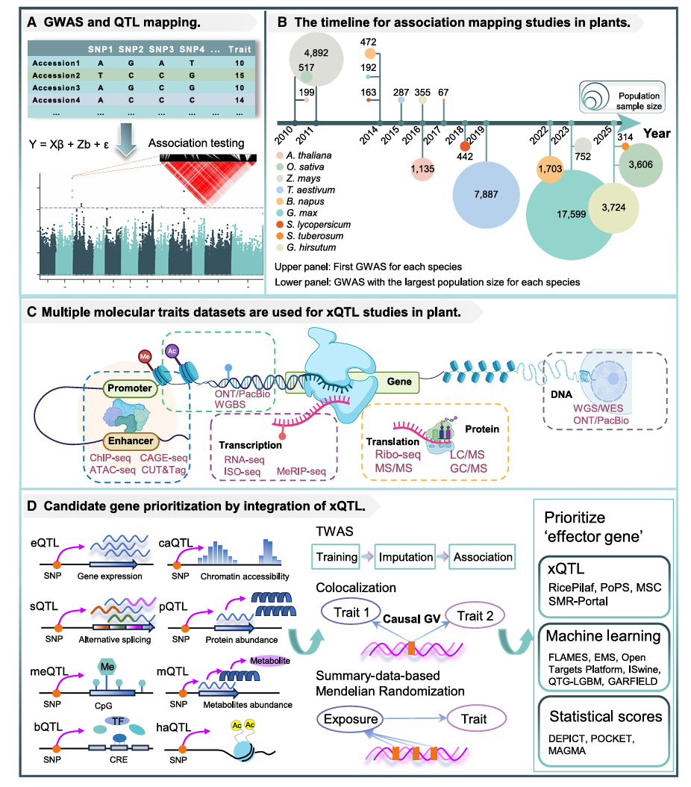
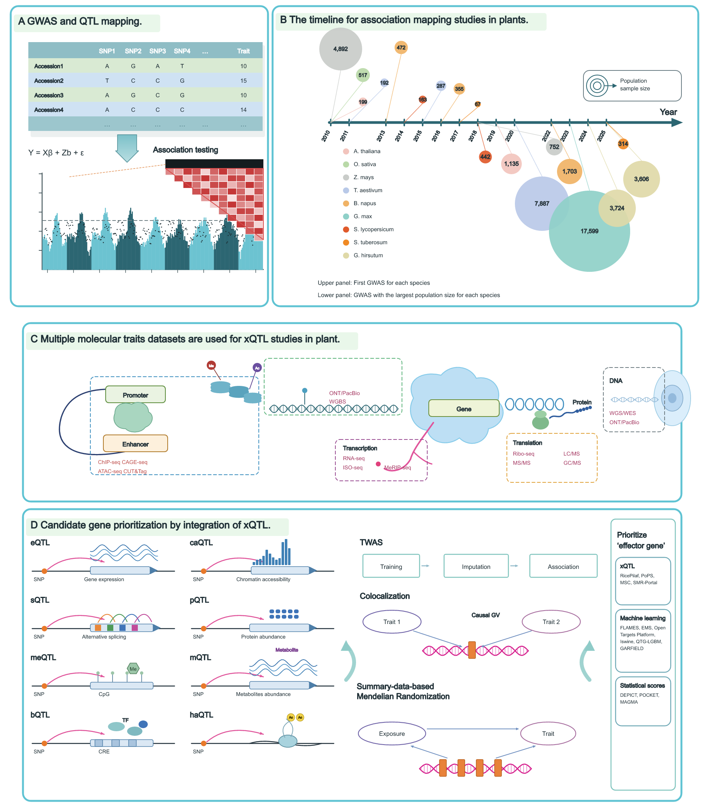
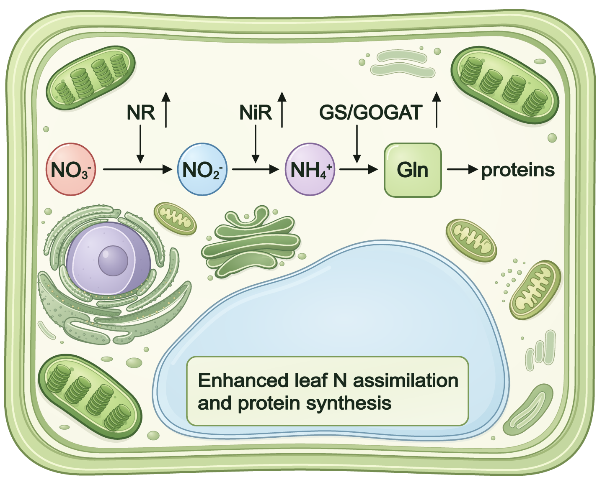
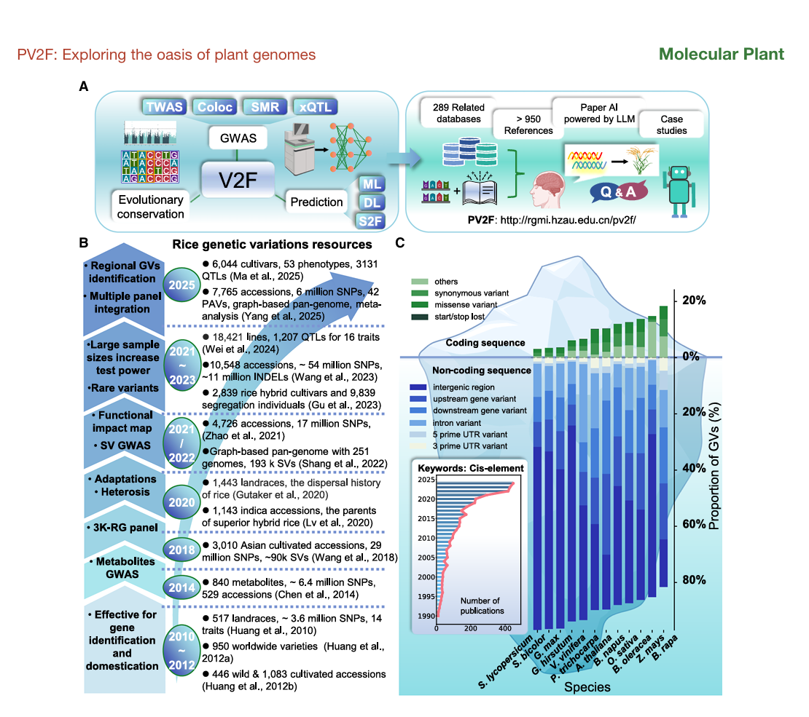
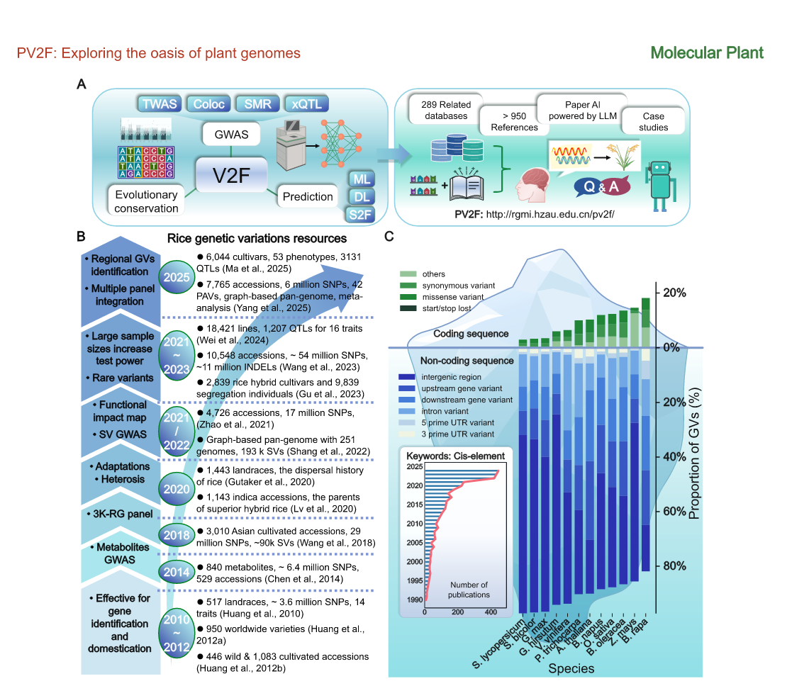

# 还在为科研绘图而烦恼么？推荐使用 Scientific Figure Reconstruction & Drawing Skill

独立的科研矢量重绘与绘制 Skill：支持**参考图语义复刻**和**自然语言生图**。
宿主负责理解对象、内部结构与关系，选择素材、Recipe 或自由绘图程序；引擎负责执行几何、样式、层级、编辑与 SVG/PNG 导出。不需要第二个看图模型、模型 API 或服务进程。

推荐用法：用 GPT、seedance 等生图模型生成你想要的风格、内容和素材，本 Skill 负责基本排版与重建 😊；局部不满意时，用截图指出具体位置，它会继续修改，尽可能交付还原的结果。也可以截图喜欢的素材，让它先生成基础绘图素材，再自行排版；或者直接给一段完整描述产出图像——这一用法比较依赖 LLM 本身的理解力。

> 让模型决定怎么画，让引擎负责画好。

## 结果

### 多组学 xQTL 参考图重绘（新）

一张四分区植物基因组图：GWAS/QTL 与关联分析、关联作图时间线、xQTL 分子数据、候选基因整合。重绘保留了全部分区结构、表内基因型、时间线气泡数值与物种图例、C 区每个方法标签、D 区八种 xQTL 与工具列。

| 完整参考图 | 整图矢量重绘 |
|---|---|
| [](examples/genomics-prioritization/reference.png) | [](examples/genomics-prioritization/redraw.svg) |

[可编辑 SVG](examples/genomics-prioritization/redraw.svg) · [PNG](examples/genomics-prioritization/redraw.png) · [绘图程序](examples/genomics-prioritization/draw.py) · [对象 ID 清单](examples/genomics-prioritization/OBJECTS.md) · [质量复核](examples/genomics-prioritization/QA.md)

### 柑橘无损品质评价（新，自然语言）

只给一段描述，不给参考图：果园取样 → 无损检测 → 参考品质测定 → 数据分析与品质预测。图中没有编造 R²、RMSE、波长、仪器型号或性能数值；比例尺仅为示意，批量统计明确标注为示意。


[可编辑 SVG](examples/citrus-quality/citrus-quality.svg) · [PNG](examples/citrus-quality/citrus-quality.png) · [Scene 工程](examples/citrus-quality/citrus-quality.scene.json) · [绘图程序](examples/citrus-quality/draw.py) · [对象 ID 清单](examples/citrus-quality/OBJECTS.md) · [质量复核](examples/citrus-quality/QA.md)

### v0.8 整图重绘与完整参考图

上方制备／给药流程、右侧肿瘤与血管、左下细胞放大和底部色板。

| 完整参考图 | v0.8 整张矢量重绘 |
|---|---|
| [](examples/v0.8/reference.png) | [](examples/v0.8/full-redraw.svg) |

[查看完整参考图](examples/v0.8/reference.png) · [下载 v0.8 整图 SVG](examples/v0.8/full-redraw.svg) · [整图 PNG 预览](examples/v0.8/full-redraw.png) · [示例来源与限制](examples/v0.8/README.md)

### 植物细胞氮同化
| 完整参考图 | 整图重绘 |
|---|---|
| [](examples/plant-nitrogen-assimilation/reference.webp) | [](examples/plant-nitrogen-assimilation/redraw.svg) |

重绘了核周内质网的多圈膜带、膜缘与膜面圆点，以及高尔基体的侧壁和堆叠关系。[可编辑 SVG](examples/plant-nitrogen-assimilation/redraw.svg)

### PV2F 植物基因组图

| 完整参考图 | 整图重绘 |
|---|---|
| [](examples/pv2f/reference.png) | [](examples/pv2f/redraw.svg) |

保留 A 区流程图、B 区水稻遗传变异资源时间线和 C 区冰山图表；微型图标与曲线简化，柱高和发表量按参考图估读。[可编辑 SVG](examples/pv2f/redraw.svg) · [相关论文（Han 等，*Molecular Plant*，2026）](https://doi.org/10.1016/j.molp.2026.05.014)

> 以上参考图均由用户提供或按用户要求用于对照，权利归各原权利人。仓库的代码许可不适用于参考图；重绘是技术性重建，不构成对原图的再许可。

## 能力

| 能力 | 实际行为 |
|---|---|
| 两类任务共用流程 | 参考／描述 → 宿主解释 → FigurePlan → 选择画法 → Scene → 实际预览 → 定向修正 |
| 参考图约束 | 参考图生成约束包：多尺度边缘分类、区域/孔洞/重复、坐标契约；按对象绑定的边界 recall/precision/偏移检查 |
| 语义草稿与分阶段检查 | `plan draft/check` 保留 unresolved，区分语义待确认与构造可编译；不补造实验步骤 |
| 关系语义 | `execute` / `check` / `semantic` 明确分工；不可执行的 execute 返回 `needs_input`，重复与镜像生成独立实例 |
| 真实候选检索 | `registry search` / `plan suggest` 返回已安装资源、适配理由与缺失部件；不存在的条目返回空 |
| 四项局部测量 | ROI 上下文、RGB/alpha 剖面、选定阈值的连通／孔洞候选、给定模板的单尺度重复候选 |
| 自由程序与几何库 | 宿主显式执行 Python/JS，消费已有 Scene 片段；复用 FontTools、可选 skia-pathops 等 |
| 可编辑矢量 | 稳定对象 ID、父子变换、路径、真 text、渐变、受限 clip/mask/occlusion、连接与独立实例 |
| 安全重跑 | B/U/C 比较旧纯生成基线、用户当前图与新候选，保留用户单独改色、移动和文字；冲突拒绝覆盖 |
| 工程与组合 | 保存重开、局部 SVG/PNG 导出、Bundle 与组合，保留实际采用的规划与测量输入 |
| 同源 PNG | 由同一 SVG 使用 resvg 渲染；测试通过不等于视觉或科学正确 |

复杂对象结构不匹配时直接使用自由程序；没有 mouse/flask/avatar Recipe，不伪造命中。Scene 是当前几何、文字和样式的唯一权威；Plan、程序、参数和测量是输入快照。加载工程、渲染、Bundle、diff/accept 不运行保存源码。

## 如何实现

1. **宿主负责语义，引擎负责几何。** 看图、拆模块、判断内部结构和画法是宿主的职责；引擎执行明确的 path、text、group、渐变和变换，并保证对象 ID 与父子关系稳定可编辑。
2. **两类任务共用一个对象图。** 参考复刻和自然语言描述最后都落到 FigurePlan / Scene；参考图额外产生约束包，用多尺度边缘、区域、孔洞和重复候选约束绘制结果，而不是把边缘自动当成语义结论。
3. **画法可选、可组合。** `filled_shape`、`stroke`、`band`、`layered_fill`、`boolean_cut`、`mask`、`occlusion`、`overlay`、`gradient`、`repeated_instances`、`text`、`program`；复杂对象先画主结构和必要部件，看到实际预览后再细化。
4. **文字与几何分离。** 所有标签是真实 `<text>`（本仓库示例共 165 / 70 个文本对象），经字体测量后显式换行；缺字或超宽会被检查，不用路径伪装文字。
5. **预览闭环。** 每轮都读整图和局部 ROI，问题定位到具体对象 ID，再改程序或参数；不以缩略图通过代替检查。示例的质量记录逐条列出发现的问题和剩余限制。

## 运行示例

```bash
python -m pip install ".[dev,construction]"
```

```bash
python examples/citrus-quality/draw.py work/citrus --scale 2 --deliver examples/citrus-quality
```

```bash
python examples/genomics-prioritization/draw.py work/genomics --scale 3 --deliver examples/genomics-prioritization
```

两个脚本只依赖本仓库与 Pillow/FontTools；输出为 `figure.svg`、`preview.png`、`scene.json` 和对象清单。宿主指南见 [SKILL.md](SKILL.md)；参考图与自然语言两条流程见 [参考图重建](references/reference-reconstruction.md) 与 [自然语言设计](references/text-design.md)。

## 目录

```text
SKILL.md                          宿主工作指南
src/scientific_figure/            引擎、CLI、Schema 与固定 Registry
references/                       两类任务与构造选择指南
docs/                             API、依赖、脚本与设计文档
scripts/                          安装、验证与本地交付脚本
tests/                            工程行为测试
examples/citrus-quality/          自然语言示例：程序、SVG/PNG、Scene、对象清单、复核
examples/genomics-prioritization/ 参考图重绘：参考、程序、SVG/PNG、Scene、对象清单、复核
examples/v0.8/                    历史整图重绘与完整参考图
examples/plant-nitrogen-assimilation/、examples/pv2f/  参考图复刻
```

## 许可

本仓库代码采用 **PolyForm Noncommercial License 1.0.0**（源码可见、仅限非商业用途），全文见 [LICENSE](LICENSE)。第三方依赖与 Registry 资产遵守各自条款，见 [THIRD_PARTY_NOTICES.md](THIRD_PARTY_NOTICES.md)。

参考图不属于代码许可范围：其权利归原作者／出版方，仅用于本仓库的对照展示，不随本仓库授予任何复用许可。商业使用请联系各参考图权利人与本仓库作者。本仓库独立于 QAagent。
