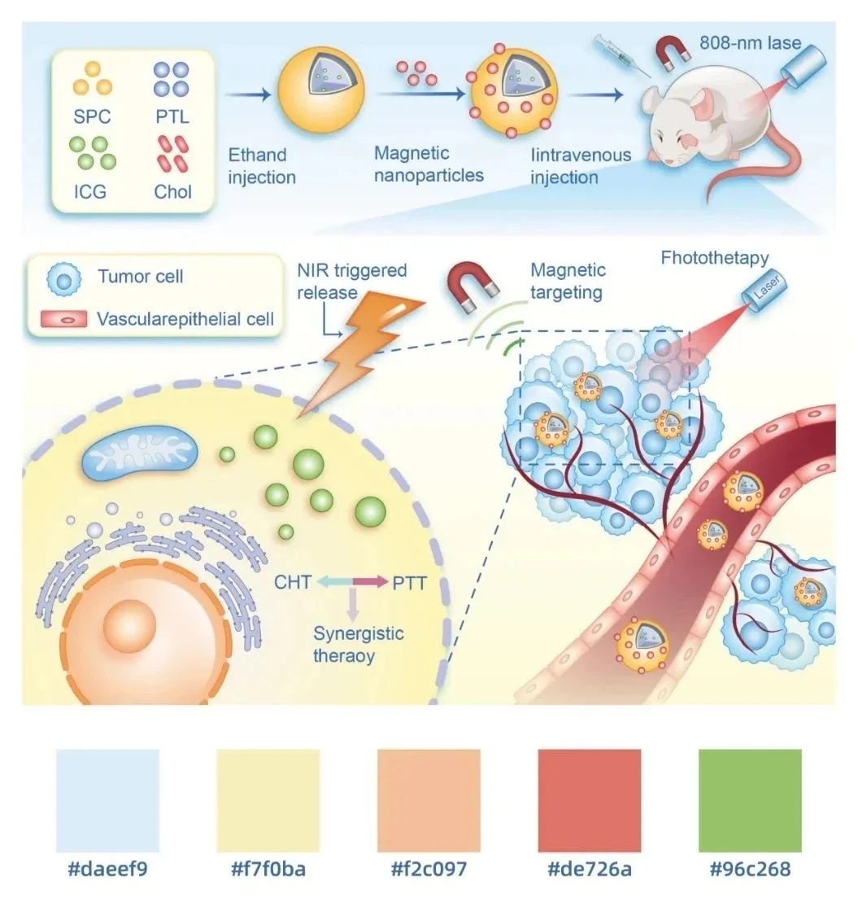
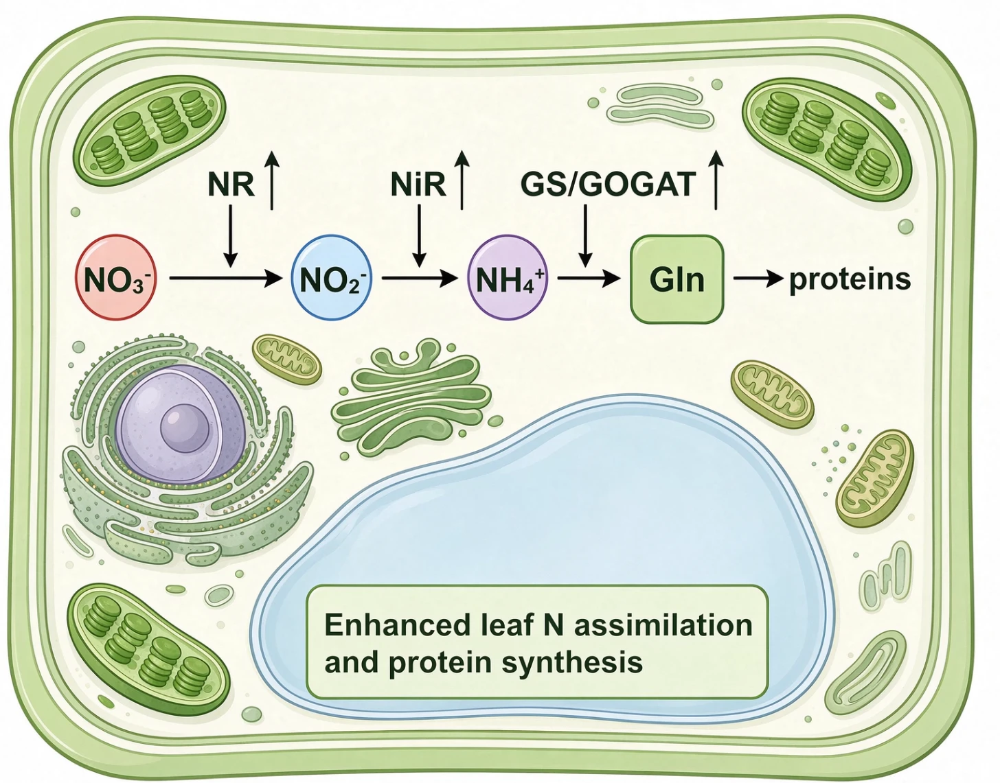

# 还在为科研绘图而烦恼么？推荐使用 Scientific Figure Reconstruction & Drawing Skill

这是一个独立的科研绘图 Skill。可以根据参考图重绘，也可以根据一段自然语言描述设计新图，交付可编辑的 SVG 和 PNG 预览。可以用截图指定要修改的局部，也可以先绘制需要的素材，再自行排版。

## 结果

### 柑橘无损品质评价

**本次重绘使用的自然语言提示词**

> 绘制一张横向科研示意图，说明如何从果园取样到无损预测柑橘品质。画出挂有不同成熟阶段果实的柑橘枝条和取样箱，为每个果实分配编号。用光学探头扫描完整果实，保存带编号的光谱记录。扫描后，从同一批果实中选取样品做参考测定，以可溶性固形物和可滴定酸为例。用相同的果实编号连接光谱和参考测定记录，按果实划分校准集和独立验证集，然后用模型预测新果实的品质，展示单果预测和批次评价两种输出。用清晰的英文标签和箭头串起四个模块，采用浅色底和植物学插画风格，交付可编辑的矢量图。


[可编辑 SVG](examples/citrus-quality/citrus-quality.svg) · [Scene 工程文件](examples/citrus-quality/citrus-quality.scene.json) · [绘图程序](examples/citrus-quality/draw.py) · [对象清单](examples/citrus-quality/OBJECTS.md)

### v0.8 科研示意图整图重绘

| 完整参考图 | 整图重绘 |
|---|---|
| [](examples/v0.8/reference.png) | [](examples/v0.8/full-redraw.svg) |

[可编辑 SVG](examples/v0.8/full-redraw.svg)

### 植物细胞氮同化

| 完整参考图 | 整图重绘 |
|---|---|
| [](examples/plant-nitrogen-assimilation/reference.webp) | [](examples/plant-nitrogen-assimilation/redraw.svg) |

[可编辑 SVG](examples/plant-nitrogen-assimilation/redraw.svg)

### PV2F 植物基因组图

| 完整参考图 | 整图重绘 |
|---|---|
| [](examples/pv2f/reference.png) | [](examples/pv2f/redraw.svg) |

[可编辑 SVG](examples/pv2f/redraw.svg) · [相关论文（Han 等，*Molecular Plant*，2026）](https://doi.org/10.1016/j.molp.2026.05.014)

> 以上参考图均由用户提供或按用户要求用于对照，权利归各原权利人。仓库的代码许可不适用于参考图；重绘是技术性重建，不构成对原图的再许可。

## 绘图方式与技术栈

宿主模型先读参考图或文字描述，梳理图的阅读顺序、主要对象和相互关系。重绘时按需测量参考图的局部轮廓、颜色和位置。根据描述新画时，宿主负责设计版式和示意表达。两类任务都可用 FigurePlan 组织绘图决策，再按对象选用可复用的绘图模板、授权素材、基础几何或自定义绘图程序。

Python 引擎用 Scene 保存图层、形状、连接和可编辑文字。FontTools 用于字体和路径处理，可选的 skia-pathops 用于几何布尔运算，Pillow 和 OpenCV 用于图像读取与局部分析。引擎导出 SVG，再由 resvg 在 CPU 上渲染 PNG。宿主查看实际预览后，可以定位到对象进行局部调整，再导出同一工程。

## 运行示例

```bash
python -m pip install ".[dev,construction]"
```

```bash
python examples/citrus-quality/draw.py work/citrus --scale 2 --deliver examples/citrus-quality
```

```bash
python examples/structural-regression/run.py work/regression --deliver examples/structural-regression
```

柑橘示例输出 `figure.svg`、`preview.png` 和 `scene.json`。宿主指南和两类任务的操作说明见 [SKILL.md](SKILL.md)、[参考图重建](references/reference-reconstruction.md) 和 [自然语言设计](references/text-design.md)。

## 目录

```text
SKILL.md                          宿主工作指南
src/scientific_figure/            引擎、CLI、Schema 与固定 Registry
references/                       两类任务与构造选择指南
docs/                             API、依赖、脚本与设计文档
scripts/                          安装、验证与本地交付脚本
tests/                            工程行为测试
examples/citrus-quality/          自然语言示例与绘图程序
examples/v0.8/                    历史整图重绘与完整参考图
examples/structural-regression/   跨学科结构回归
examples/plant-nitrogen-assimilation/、examples/pv2f/  参考图复刻
```

## 许可

本仓库代码采用 **PolyForm Noncommercial License 1.0.0**（源码可见、仅限非商业用途），全文见 [LICENSE](LICENSE)。第三方依赖与 Registry 资产遵守各自条款，见 [THIRD_PARTY_NOTICES.md](THIRD_PARTY_NOTICES.md)。

参考图不属于代码许可范围：其权利归原作者／出版方，仅用于本仓库的对照展示，不随本仓库授予任何复用许可。商业使用请联系各参考图权利人与本仓库作者。本仓库独立于 QAagent。
