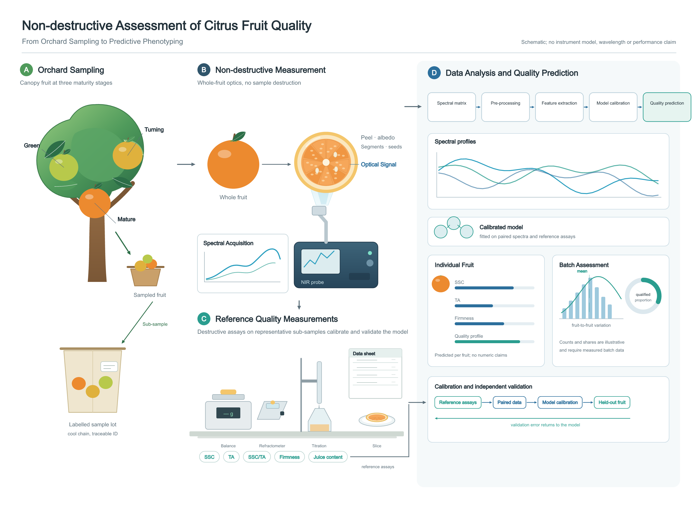
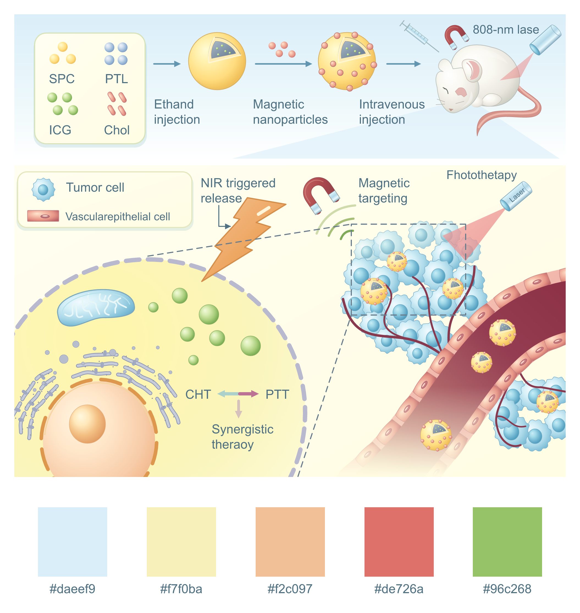

# Scientific Figure Reconstruction & Drawing Skill

一个独立的科研绘图 Skill：根据参考图重绘，或根据自然语言描述设计新图。交付可编辑的 SVG 和 PNG 预览，也可以用截图指出需要修改的局部。

A standalone skill for redrawing scientific figures from references and creating new figures from natural-language descriptions. It delivers editable SVGs and PNG previews. Use a screenshot to identify any region you want revised.

## 示例 / Examples

### 柑橘无损品质评价

*Non-destructive assessment of citrus fruit quality*

**本次绘图提示词（中文原文） / Drawing prompt for the new figure (original Chinese)**

> 绘制一张横向科研示意图，说明如何从果园取样到无损预测柑橘品质。画出挂有不同成熟阶段果实的柑橘枝条和取样箱，为每个果实分配编号。用光学探头扫描完整果实，保存带编号的光谱记录。扫描后，从同一批果实中选取样品做参考测定，以可溶性固形物和可滴定酸为例。用相同的果实编号连接光谱和参考测定记录，按果实划分校准集和独立验证集，然后用模型预测新果实的品质，展示单果预测和批次评价两种输出。用清晰的英文标签和箭头串起四个模块，采用浅色底和植物学插画风格，交付可编辑的矢量图。

**English translation / 英文译文**

> Draw a landscape scientific schematic that explains how citrus quality is predicted non-destructively, from orchard sampling through prediction. Show a citrus branch with fruit at different stages of maturity and a sampling crate, and assign each fruit an ID. Scan the intact fruit with an optical probe and store the spectra with their fruit IDs. After scanning, select fruit from the same batch for reference assays, using soluble solids and titratable acidity as examples. Match the spectral and reference records by fruit ID, split by fruit into calibration and independent validation sets, then use the model to predict fruit quality from new scans. Show two outputs: individual-fruit predictions and batch assessment. Use clear English labels and arrows to connect the four modules, with a light background and a botanical illustration style. Deliver an editable vector figure.

**** GPT 6.1sol+skill / Current drawing**

[](examples/citrus-quality/citrus-quality.svg)

[可编辑 SVG / Editable SVG](examples/citrus-quality/citrus-quality.svg) · [Scene 工程 / Scene project](examples/citrus-quality/citrus-quality.scene.json) · [绘图程序 / Drawing script](examples/citrus-quality/draw.py) · [对象清单 / Object inventory](examples/citrus-quality/OBJECTS.md)


### v0.8 科研示意图整图重绘 / Full scientific schematic redraw

| 完整参考图 / Full reference | 整图重绘 / Redraw |
|---|---|
| [](examples/v0.8/reference.png) | [](examples/v0.8/full-redraw.svg) |

### 植物细胞氮同化 / Nitrogen assimilation in a plant cell

| 完整参考图 / Full reference | 整图重绘 / Redraw |
|---|---|
| [](examples/plant-nitrogen-assimilation/reference.webp) | [](examples/plant-nitrogen-assimilation/redraw.svg) |

### PV2F 植物基因组图 / PV2F plant genome figure

| 完整参考图 / Full reference | 整图重绘 / Redraw |
|---|---|
| [](examples/pv2f/reference.png) | [](examples/pv2f/redraw.svg) |

[相关论文 / Source paper: Han et al., *Molecular Plant* (2026)](https://doi.org/10.1016/j.molp.2026.05.014)

## 绘图方式与技术栈 / How it works

宿主模型先理解参考图或文字描述，梳理阅读顺序、对象和相互关系。参考图重绘可以按需测量局部轮廓、颜色和位置；根据描述新画时，宿主负责设计版式。两类任务都可用 FigurePlan 组织绘图决策，按对象选用绘图模板、授权素材、基础几何或自定义绘图程序。

The host model interprets the image or text and decides the reading order, objects, and relationships. For a redraw, it can measure local contours, colors, or positions; for a new figure, it designs the layout. Both workflows can organize drawing decisions in FigurePlan and choose among reusable templates, licensed assets, geometric primitives, and custom drawing scripts.

Python 引擎用 Scene 保存图层、形状、连接和可编辑文字。FontTools 处理字体与路径，可选的 skia-pathops 处理几何布尔运算，Pillow 和 OpenCV 用于图像读取与局部分析。引擎导出 SVG，由 resvg 在 CPU 上渲染 PNG。宿主检查实际预览后，可以在同一工程里调整指定对象。

The Python engine stores layers, shapes, connectors, and editable text in a Scene. It uses FontTools for fonts and paths, optional skia-pathops for Boolean geometry, and Pillow and OpenCV for image handling and local analysis. It exports SVG and uses resvg to render PNG previews on the CPU. The host can inspect the preview and revise specific objects in the same project.

## 运行示例 / Run the examples

```bash
python -m pip install ".[dev,construction]"
```

```bash
python examples/citrus-quality/draw.py work/citrus --scale 2 --deliver examples/citrus-quality
```

```bash
python examples/structural-regression/run.py work/regression --deliver examples/structural-regression
```

柑橘示例输出 `figure.svg`、`preview.png` 和 `scene.json`。

The citrus example writes `figure.svg`, `preview.png`, and `scene.json`.

[宿主指南 / Skill guide](SKILL.md) · [参考图重建 / Reference reconstruction](references/reference-reconstruction.md) · [自然语言设计 / Text-to-figure design](references/text-design.md)

## 目录 / Repository layout

| 路径 / Path | 内容 / Contents |
|---|---|
| `src/scientific_figure/` | 引擎、CLI、Schema 与 Registry / Engine, CLI, schemas, and registry |
| `references/`, `docs/` | 绘图指南与技术文档 / Drawing guides and technical docs |
| `scripts/`, `tests/` | 安装、验证和工程测试 / Setup, verification, and tests |
| `examples/` | 自然语言绘图与参考图重绘 / Text-to-figure and reference redraw examples |

## 许可 / License

仓库代码采用 **PolyForm Noncommercial License 1.0.0**，详见 [LICENSE](LICENSE)。第三方依赖和素材遵守各自条款，见 [THIRD_PARTY_NOTICES.md](THIRD_PARTY_NOTICES.md)。参考图仅作对照展示，版权归各原权利人，不适用仓库的代码许可。

Code is available under the **PolyForm Noncommercial License 1.0.0**; see [LICENSE](LICENSE). Third-party dependencies and assets retain their own terms; see [THIRD_PARTY_NOTICES.md](THIRD_PARTY_NOTICES.md). Reference images are shown for comparison, remain the property of their respective rights holders, and are not covered by the code license. This repository is independent of QAagent.
