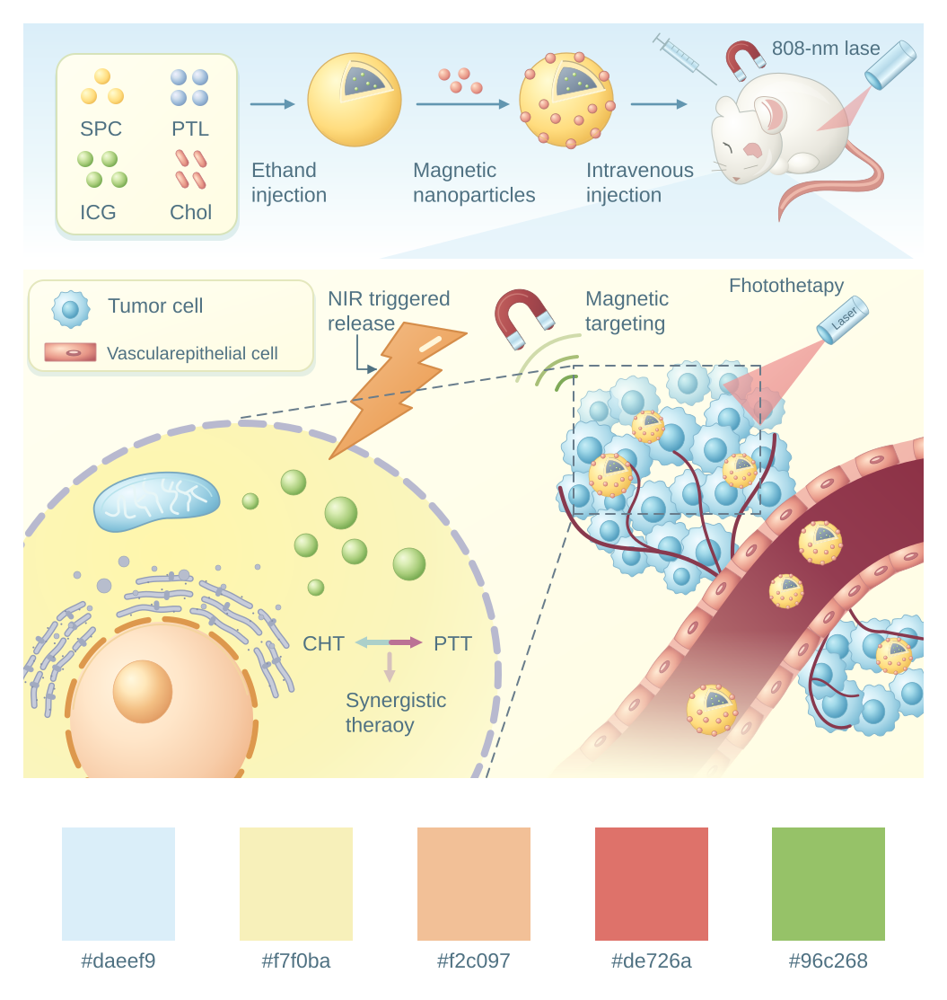
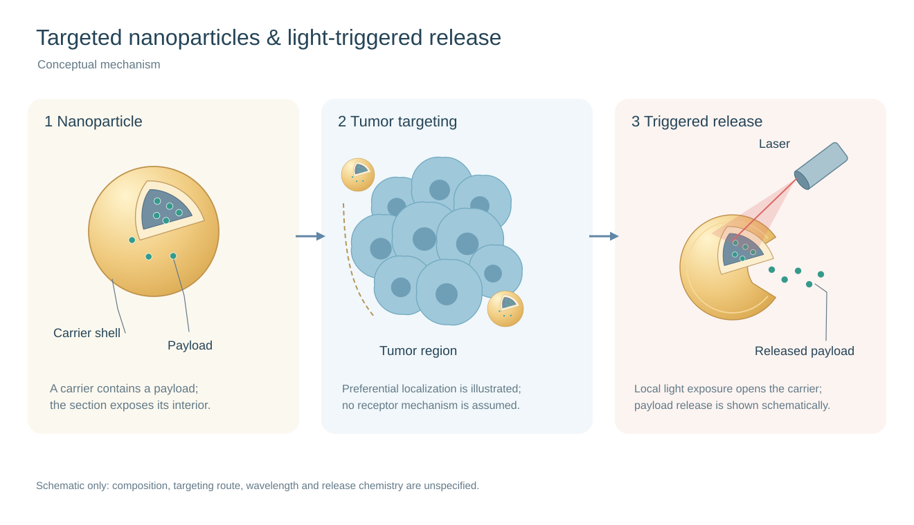

# Scientific Figure Reconstruction & Drawing Skill

**Skill：`scientific-figure` · Engine：v0.9.0 · Python：>=3.12 · CPU / 无 GUI**

独立的科研矢量重绘与绘制 Skill。支持**参考图语义复刻**和**自然语言生图**：调用它的宿主负责理解对象、内部结构与关系，选择素材、Recipe 或自由绘图程序；引擎负责执行几何、样式、层级、编辑和 SVG/PNG 导出。无需增加第二个看图模型、模型 API 或服务进程。

> 让模型决定怎么画，让引擎负责画好。

## v0.8 整图重绘与完整参考图

以下按提供者要求展示 **v0.8 历史整图重绘结果**，不将它标成 v0.9 新重绘成绩。左侧是完整参考图，右侧是使用本引擎完成的整张重绘，包含上方制备／给药流程、右侧肿瘤与血管、左下细胞放大图和底部色板。

| 完整参考图 | v0.8 整张矢量重绘 |
|---|---|
|  |  |

[查看完整参考图](examples/v0.8/reference.png) · [下载 v0.8 整图 SVG](examples/v0.8/full-redraw.svg) · [整图 PNG 预览](examples/v0.8/full-redraw.png) · [示例来源与限制](examples/v0.8/README.md)

SVG 中保留可编辑路径、分组、渐变和真实文字，不嵌入参考位图。ER 形态、小鼠解剖和柔和笔绘边缘仍有近似；原图疑似错字在主结果中保留。参考图的权利归原权利人，本项目不为其授予复用许可；未做领域科学审核。

## v0.9 能做什么

| 能力 | 实际行为 |
|---|---|
| 两类任务共用流程 | 参考／描述 → 宿主解释 → FigurePlan → 选择画法 → Scene → 实际预览 → 定向修正 |
| 草稿与分阶段检查 | `plan draft/check` 保留 unresolved，区分语义待确认与构造可编译；不补造实验步骤 |
| 真实候选检索 | `registry search` / `plan suggest` 返回已安装资源、适配理由与缺少部件；不存在的条目返回空 |
| 四项局部测量 | ROI 上下文、RGB/alpha 剖面、选定阈值的连通／孔洞候选、给定模板的单尺度重复候选 |
| 自由程序与几何库 | 宿主显式执行 Python/JS，消费已有 Scene 片段；复用 FontTools、可选 skia-pathops 等 |
| 可编辑矢量 | 稳定对象 ID、父子变换、路径、真 text、渐变、受限 clip/mask/occlusion、连接与独立实例 |
| 安全重跑 | B/U/C 比较旧纯生成基线、用户当前图与新候选，保留用户单独改色、移动和文字；冲突拒绝覆盖 |
| 工程与组合 | 保存重开、局部 SVG/PNG 导出、Bundle 与组合，保留实际采用的规划和测量输入 |
| 同源 PNG | 由同一 SVG 使用 resvg 渲染；不能将测试通过当成视觉或科学正确性 |

本地目录含 15 个 Recipe 族、2 个符号族元数据和 1 个有许可的 Twemoji 柠檬资产。复杂对象结构不匹配时可以直接使用自由程序；没有 mouse/flask/avatar Recipe，不伪造命中。

Scene 是当前几何、文字和样式的唯一权威；Plan、程序、参数和测量为输入快照。加载工程、渲染、Bundle、diff/accept 不运行保存源码。`python -I` 是隔离解释器选项，不是安全沙箱。

## v0.9 自然语言绘图示例

描述：“画一个纳米颗粒靶向肿瘤并通过激光触发释放的机制示意图。”



[SVG](examples/v0.9/targeted-release.svg) · [PNG](examples/v0.9/targeted-release.png) · [完整宿主绘图程序](scripts/draw_targeted_release_v09.py)

图为宿主新设计的示意：粒子、肿瘤目标、激光和释放采用同一引擎绘制，使用自由片段及两个 arrow Recipe。没有将制备、注射、配体、受体、波长或剂量当成描述中已有条件。宿主实际看图后移动了与壳体碰撞的释放标签和引线。它不认证某一种实际释放化学机制。

## 安装

```bash
git clone https://github.com/w1-23/scientific-figure.git
```

```bash
cd scientific-figure
```

在 Python >=3.12 的环境中，自动建立 `.venv` 并安装运行、构造与测试依赖：

```bash
python -I scripts/bootstrap.py --venv .venv --dev
```

Windows 检查入口：

```bash
.venv/Scripts/figure-cli.exe doctor --json
```

Linux 检查入口：

```bash
.venv/bin/figure-cli doctor --json
```

已有环境可直接安装：

```bash
python -m pip install ".[dev,construction]"
```

[完整依赖、Windows/Linux/Conda 安装、字体、版本约束与 wheel 用法](docs/dependencies-and-installation.md)

没有 GPU 实现，无需 CUDA 或模型权重。字体使用本机文件；Windows 实测 Arial，Linux 实测 DejaVu Sans，不分发系统字体。WSL 的输出工程建议放在 Linux 原生文件系统，避免 Windows 挂载盘不支持所需原子发布操作。

## 使用 Skill 和脚本

将本仓库中含 `SKILL.md` 的目录交给支持本地 Skill 的宿主，或让已有 Agent 读取 [SKILL.md](SKILL.md)，并在上述安装环境中调用 `figure-cli`。宿主本身提供看图与推理能力；本项目不启动另一个 Agent 服务。

两份按需指南：[参考图重建](references/reference-reconstruction.md) · [自然语言设计](references/text-design.md) · [构造方法选择](references/construction-selection.md)。

安装后，用激活的环境执行完整合成验证链（目标目录需尚不存在）：

```bash
python -I scripts/verify_v09_workflow.py --output work/workflow09
```

重新生成自然语言图：

```bash
python -I scripts/draw_targeted_release_v09.py --output work/targeted-release --revision 1
```

若使用未激活的环境，将 `python` 替换为 `.venv/Scripts/python.exe` 或 `.venv/bin/python`。Linux 下可将输出改为 `~/figure-work/workflow09`。

[脚本用途、参数、输入输出及可移植范围](docs/scripts.md) · [CLI 与请求契约](docs/semantic-planning-workflow.md) · [局部测量](docs/local-measurements.md) · [构造 API](docs/construction-tools.md) · [编辑与生成协议](docs/generation-and-effects.md) · [Bundle/组合](docs/bundles-and-composition.md)

## 验证事实

- v0.9 完整回归：**969 passed、5 skipped、10 subtests passed**；5 项跳过为 Windows 符号链接权限限制。
- Windows/Linux 的实际命令入口、保存、编辑、导出和组合链通过；同一 wheel 内 **74 个应用文件**与两个独立应用安装位置逐字节一致。
- 参考与描述两类图均实际看图、各一轮定向修正，均验证改色／移动／改字、两项局部导出与重开。
- 本地源码、示例和私有包已校验 CRC/SHA-256；私有包独立程序解压复现通过。此仓库不上传完整私有包。

[实际验证记录](verification/README.md) · [v0.9 交付说明与限制](docs/delivery-0.9.0.md)

这些是开发与工程验证，不是视觉得分或科学认证。两平台复用已有依赖安装应用，不称空环境全依赖离线安装；不保证不同字体平台像素相同。没有 OCR、自动科学理解、隐藏结构恢复或全自动任意图高保真能力。

## 目录与许可

```text
SKILL.md                    宿主工作指南
src/scientific_figure/      引擎、CLI、Schema 与固定 Registry
references/                 两类任务与构造选择指南
docs/                       API、依赖、脚本与设计文档
scripts/                    安装、绘图、验证及本地交付维护脚本
tests/                      工程行为测试
examples/v0.8/              本次指定展示的历史结果与参考图
examples/v0.9/              原创描述图 SVG/PNG
deliverables/               v0.9.0 应用 wheel
verification/               本地验证事实与原交付摘要
```

项目代码尚未指定统一开源许可证，不自动授予 MIT 等额外许可。第三方依赖和 Registry 资产遵守其各自条款，详见 [THIRD_PARTY_NOTICES.md](THIRD_PARTY_NOTICES.md)。参考图单独注明来源与权利；代码许可与图像许可互不替代。此仓库独立于 QAagent。
